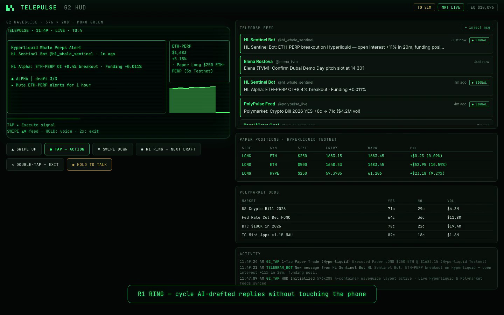

<div align="center">

# TELEPULSE HUD

### Read Telegram. Write back. Trade the signal — all without touching your phone.

**Heads-Up Telegram Sentinel · AI Voice Responder · Testnet DeFi Terminal**  
for **Even Realities G2** smart glasses

[](https://dorahacks.io/hackathon/even-realities)
[-0a0f0c)](https://dorahacks.io/hackathon/even-realities)
[](https://dorahacks.io/hackathon/even-realities)
[](https://dorahacks.io/hackathon/even-realities)
[](https://www.npmjs.com/package/@evenrealities/even_hub_sdk)
[](LICENSE)

**Builder:** [Kushagra Gupta](https://github.com/kushagragupta-23) · Built during build week, Nov 23–29 2026

</div>

---

## Demo

<video src="https://github.com/kushagragupta-23/telepulse-eveng2/raw/main/docs/telepulse-demo.mp4" controls width="100%"></video>

> **▶ [Watch the 90-second demo](docs/telepulse-demo.mp4)** — voiceover walkthrough of the full read-and-write loop. No glasses? Same file runs in the browser lens below.

[](docs/telepulse-demo.mp4)

---

## One glance is all it takes

We all live on Telegram — alpha groups, founder chats, trading bots. But every ping
fights for your phone, half of them are scams, and the *actionable* ones die waiting
for you to unlock a screen.

**TelePulse HUD** moves that whole loop into your glasses:

> A whale alert lands on Telegram → the HUD shows one glance card → you tap once →
> the linked trade executes on Hyperliquid testnet → the receipt lands back in the
> same thread. **Three seconds. Phone never leaves your pocket.**

## The read & write loop

| Gesture | What it does |
|---|---|
| **Swipe ▲▼** | Move through the glance queue — Telegram cards, markets, positions |
| **Tap** | *Smart action* — send the AI-drafted reply, or execute the signal's linked paper trade |
| **R1 ring tap** | Cycle AI-drafted replies without touching anything else |
| **Long-press → release** | Push-to-talk: *"paper long SOL, two fifty dollars"* → parsed → executed; or speak a reply → sent to Telegram |
| **Glasses menu** | Switch desks: Telegram · HL Perps · Polymarket · Gram Wallet · Activity · Refresh |
| **Double-tap** | System exit-confirmation dialog (`shutDownPageContainer(1)` — the QA-required path) |

## Why judges should care

| Rubric | How TelePulse hits it |
|---|---|
| **Usefulness on G2 — 30%** | A real daily loop for the exact user: Telegram signal groups → instant action, works phone-locked |
| **Read & write — 25%** | Tap/ring/voice writes in <3s; AI drafts beat dictation; signal→trade is one tap end-to-end |
| **Technical — 20%** | Live `allMids` marks, real Telegram Bot bridge, serialized image pipeline, debounced BLE-safe render queue, 11 unit tests |
| **UX — 15%** | 5-container layout, `textColor` brightness hierarchy, threat-dimmed phishing cards, sparkline via `updateImageRawData` |
| **Business & safety — 10%** | Paper/testnet only, zero custody, secrets on the proxy, drainer sieve kills phishing before the lens |

## Architecture

```
G2 glasses ◄─BLE─► Even App WebView (this app · Even Hub SDK)
                     │
                     ├─ HudEngine          576×288 containers · event routing · voice FSM
                     ├─ BrowserEvenAdapter renders the REAL containers in-browser (glasses-free demo)
                     │
                     ▼ /api/* (whitelisted in app.json · CORS-clean)
           Backend proxy — secrets NEVER ship in the .ehpk
             ├─ Telegram Bot API   live poll + sendMessage
             ├─ Hyperliquid /info  live allMids marks + funding
             ├─ Polymarket Gamma   live event odds
             ├─ Paper engine       positions · PnL · margin (testnet only)
             ├─ Threat sieve       drainer/phishing URLs blocked pre-display
             └─ Voice intent       transcript → REPLY | PAPER_TRADE | SWITCH_MODE
```

## The HUD, container by container

```
┌ hdr ───────────────────────────────────────────┐  text · brightness 4
│ TELEPULSE · 11:46 · LIVE · TG:4                │
├ main ────────────────────────────┬ side ───────┤  text · capture · border 7
│ Hyperliquid Whale Perps Alert    │ ETH-PERP    │  text · brightness 3
│ HL Sentinel Bot · 1m ago         │ $1,684      │
│ ETH-PERP OI +8.4% breakout       │ +5.18%      │
│ ◆ ALPHA | draft 1/3              │ signal →    │
│ ▸ Paper Long $250 ETH-PERP       ├ spark ──────┤
│                                  │ ▂▃▅▇█▆▇▅   │  image · grey4 pipeline
├ act ─────────────────────────────┴─────────────┤  text · brightness 2
│ TAP ▸ Execute signal                           │
│ SWIPE ▲▼ feed · HOLD: voice · 2x: exit        │
└────────────────────────────────────────────────┘
```

All 5 containers use `zOrderIndex` (all-or-nothing rule), `textColor` for
hierarchy, and exactly one `isEventCapture: 1`. Text updates go through
`textContainerUpgrade` (flicker-free); the sparkline rides `updateImageRawData`
with serialized sends.

## Run it — no glasses required

```bash
npm install
npm run dev          # http://localhost:5173 — browser lens + gesture deck + API
```

The browser adapter draws the **actual container objects** your app pushes —
tap, swipe, ring, long-press, contextual menu and PCM audio are all real events
on the real code path.

```bash
npm run simulate     # official evenhub-simulator against the dev server
npm test             # 11 vitest cases — sieve, paper engine, voice intents
npm run build        # tsc + vite → dist/
npm run pack         # → telepulse.ehpk
```

**Real G2:** `npm run dev -- --host` → `npx evenhub qr --url http://<lan-ip>:5173` → scan in the Even app.

**Live Telegram bridge (optional):** copy `.env.example` → `.env`, set
`TELEGRAM_BOT_TOKEN` + `TELEGRAM_DEFAULT_CHAT_ID`, run `npm run server`. Without
a token the app runs the simulated bridge — every other feature stays live.

## What's real vs simulated

| Integration | Status |
|---|---|
| Hyperliquid marks (`allMids`) | **Live API** |
| Polymarket odds (Gamma) | **Live API** |
| Telegram 2-way (Bot API) | **Live when token set** · simulated bridge otherwise |
| Trading | **Paper/testnet only** — receipts log to the activity feed |
| Gram Wallet | **Read-only watch** — no custody, ever |
| STT | Raw PCM → intent parser (Whisper pluggable via `.env`) |

## Safety & rules compliance

- **Money:** testnet / paper / read-only only — no user funds, no financial advice
- **Secrets:** never bundled — `app.json` whitelists the proxy; keys live in `.env`
- **Privacy:** phishing/drainer URLs are stripped before text reaches the lens
- **Exit path:** root double-tap → `shutDownPageContainer(1)` system dialog
- **Manifest:** `TelePulse HUD` ≤20 chars, no "Even", `edition 202601`, SDK floor `0.0.16`

## API feature requests (≤5)

1. **Even Hub SDK** — host-side Whisper streaming instead of raw PCM plumbing.
2. **Telegram Bot API** — scoped "glance tokens": read-only, per-chat, TTL'd.
3. **Hyperliquid `info`** — whitelisted websocket mid-price channel for WebView origins.
4. **Polymarket Gamma** — a single-call `/top-movers` digest for glance cards.
5. **Even Hub SDK** — partial-region flags on `textContainerUpgrade` so one field can re-render without a full-content send.

## What existed before Nov 23

All application code was written during build week. Only public libs/APIs used:
`@evenrealities/even_hub_sdk`, `evenhub-cli`, `evenhub-simulator`, Vite,
TypeScript, Vitest, Playwright (demo recording only), edge-tts (video voiceover
only), and the public Hyperliquid / Polymarket / Telegram APIs.

## Repo layout

```
app.json                          Even Hub manifest (edition 202601)
server/api.ts                     proxy · paper engine · sieve · intents
server/standalone.ts              standalone backend (:8787)
src/display/HudEngine.ts          G2 screen engine (containers, events, voice)
src/display/BrowserEvenAdapter.ts browser twin of the SDK bridge + lens DOM
src/display/sparkline.ts          grey4 sparkline encoder (image pipeline)
src/main.ts                       companion UI · bridge select · demo mode
tests/api.test.ts                 11 tests
scripts/record-demo.mjs           Playwright → webm → mp4 demo recorder
docs/telepulse-demo.mp4           narrated walkthrough (1:26)
docs/narration.txt                voiceover script
```

<div align="center">

**TelePulse HUD** — read it, write it, three seconds flat.

Built by [Kushagra Gupta](https://github.com/kushagragupta-23) for the
[Heads Up: Even Realities Hackathon](https://dorahacks.io/hackathon/even-realities) · MIT

</div>
